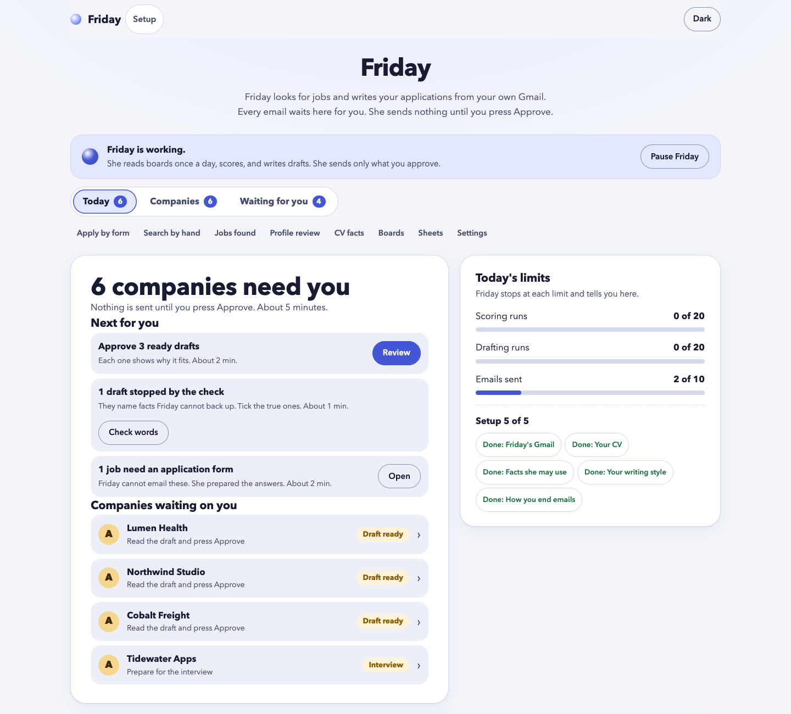

# Friday 1.0.0

Friday looks for jobs and writes your job applications. She uses your own Claude Code, your own Gmail and your own CV.
She runs on your computer. Nothing leaves it except the emails you approve, the job pages she reads, and the text she gives to your own Claude Code.

*The Today page, shown with made-up sample jobs. It lists what needs your approval and what Friday did today.*

**Friday never sends an email on her own.** Every email waits on a page for you. You press Approve. Then you have 10 seconds to undo.

## What you need

1. A computer with macOS, Windows or Linux.
2. Python 3.11, 3.12 or 3.13. Get it at https://www.python.org/downloads/ (on Windows, tick "Add python.exe to PATH").
3. Claude Code, installed and signed in. Get it at https://docs.claude.com/en/docs/claude-code . Open a terminal, type `claude` and sign in once.
4. A Gmail account with 2-step verification, so you can make an app password (the setup page shows how).
5. Your CV as a PDF.

## Install

**From a zip.** Unzip the file. Put the `friday` folder anywhere you like.

**From GitHub.** If the owner added you to the private repository, sign in to GitHub on your computer, open a terminal and run:

    git clone <the address the owner gave you> friday

Then do the same as for the zip.

## Start Friday

- macOS: double-click **Start Friday.command**. If macOS refuses, right-click it, choose Open, then Open.
- Windows: double-click **Start Friday.bat**.
- Linux: run `./start-friday.sh` in a terminal.

The first start installs Friday's packages. It takes about a minute and needs the internet. Then your browser opens.
Keep the window open while Friday works. Close it to stop her.

## First run

The first-run page has six steps. Each one saves on its own.

1. Check that Claude works.
2. Connect your Gmail. You make an app password at https://myaccount.google.com/apppasswords and paste it. Friday keeps it in a private folder on this computer. She never shows it again.
3. Add your CV (a PDF). Tick the facts Friday may use. She writes only what you tick.
4. Say where you live, which job titles you want, how you end emails, and which companies she must never write to (your current employer, for example). Friday assumes nothing about you.
5. Let Friday read the job emails you sent before, to learn your style. She only reads. You keep or remove each item, then approve.
6. Switch Friday on.

## Daily use

Open Friday in your browser (the start window shows the address). Once a day Friday reads the job boards you gave her, scores the jobs, and writes drafts for the good ones.

- **Waiting for you** lists the drafts. Read one, edit it, then Approve or Reject.
- **Apply by form** and **Search by hand** list jobs Friday cannot email. She does not fill forms for you.
- **Profile review** and **CV facts** control what she says about you.
- **Boards** and **Sheets** are the companies she watches. You can import a list from a CSV file or a spreadsheet.
- The line at the top says **what Friday needs from you** when something blocks her.
- **Pause** stops everything at once. Friday also has daily and hourly limits on sending, and 40 Claude runs a day.

## What it costs

Friday is free. She uses your Claude Code, so her work counts against your Claude usage. Her limit is 40 Claude runs a day. Gmail is free.

## Your privacy

- Your CV, jobs, drafts and settings are in a folder on this computer. On macOS it is `~/Library/Application Support/Friday`, on Windows `%APPDATA%\Friday`, on Linux `~/.local/share/friday`.
- Your Gmail login is in a private settings folder (`~/.config/friday` on macOS and Linux, `%APPDATA%\Friday\config` on Windows). It is never in the Friday folder and never in a log.
- The reader of job pages runs apart from your files and secrets.
- Nobody else gets your data. There is no account and no server.

## Update

- From GitHub: double-click **Update Friday** (or run `git pull` in the folder).
- From a zip: unzip the newer zip and start Friday from the new folder. Your data stays, because it is kept outside the folder.

## Uninstall

Run **Uninstall Friday**. It removes Friday's packages. It asks before it deletes your data and your Gmail login. Then delete the Friday folder.

## If something goes wrong

- Friday says she cannot find Python or Claude: install it with the links above, then start her again.
- The page does not open: open the address from the start window by hand. It looks like http://127.0.0.1:8795/ .
- The log is in the Friday data folder, in `friday.log`. It never holds your password.
